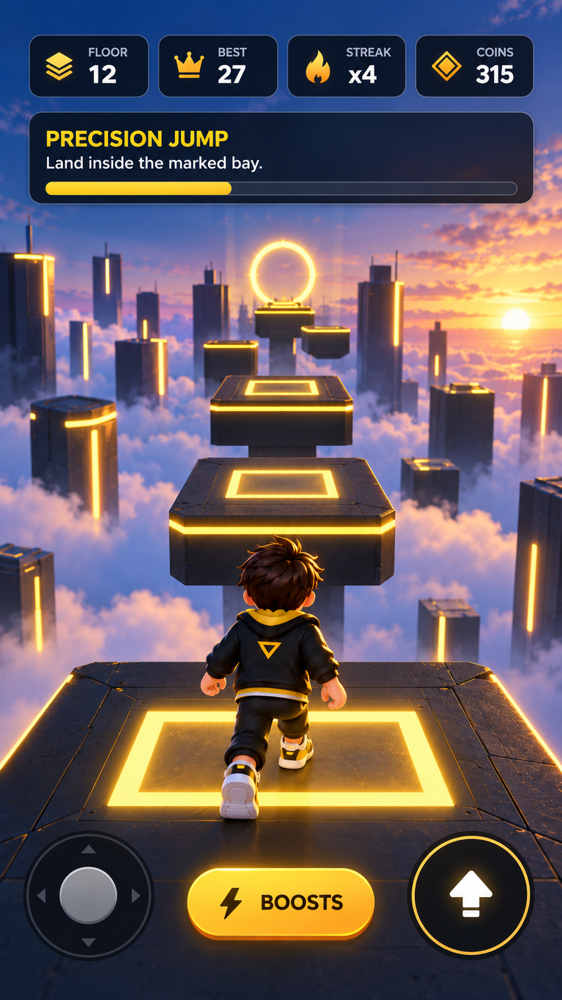

# Repair Empire Art Direction

## Target
Clean modern city-service aesthetic. Dark navy interface surfaces with orange used as action/accent rather than washing every control.

## Palette
- Deep navy: #071727
- Panel: #0D263C
- Orange action: #FF6D23
- Orange highlight: #FF9A36
- Cyan navigation: #2DBBFF
- Success green: #39D47A
- Primary text: #F7FAFF
- Secondary text: #B5C4D3

## City
- Wide central road with sidewalks and clear customer pull-off zones.
- Repair Empire workshop is a hero landmark.
- Background buildings use low-cost modular silhouettes.
- Navigation arrows stay cyan and never compete with orange action UI.

## Vehicle
White service van with orange/navy brand treatment. Camera keeps road and route marker visible.

## UI
Top: Cash | Level/XP | Tool | Settings.
Upper-left: one service-call card.
Right: Tablet action.
Bottom: steering left/right + Brake + Accelerate.
Tablet: high-contrast dark navy shell, orange active tab/action, white text, light blue-gray metadata.

## Primary visual reference

This image is the binding visual target for the branded service van, contemporary city, workshop/HQ, navigation language, service-call presentation and tablet UI. The concept contains multiple UI states: the Tablet and detailed job interfaces are contextual overlays and must not cover normal driving.

### Non-negotiable visual gates
- Driving view prioritizes road, route guidance and vehicle readability; HUD stays compact.
- The city must read as a designed service district, not a corridor of primitive boxes.
- The van is a hero asset with recognizable Kamilunavo/Repair Empire branding and clear driving feedback.
- Navy is the structural UI color; orange is an action/accent color, not a full-screen wash.
- Tablet content must maintain high contrast and readable row/action hierarchy on small phones.
- Default road network and vehicle physics must not allow routine soft-locks or trapping.

## 2026-10-09 service dashboard revision

The user's approved menu reference supersedes the original full dark tablet treatment. Repair keeps its own workshop identity: a warm ivory menu, dark navy lettering, muted green-blue scenic panels, white illustrated cards and a fixed orange primary action. The supplied Rising Steps screenshot is a hierarchy reference only; no fantasy artwork, game branding or third-party assets are copied. Driving retains compact navy overlays, orange service actions and cyan route guidance.

Normal entry opens the company dashboard. Its hero shows the live route or company progress; all eight specialist sections are exposed as illustrated cards. Four small permanent destinations (Home, Calls, Workshop, Shop), an options shortcut and the persistent drive action reduce navigation overhead. Jobs retain accurate individual service diagrams, paid status, requirements and payouts. Narrow usable panes stack commerce/settings actions rather than reducing touch targets.

Original code-drawn city, customer, van, workshop, tools, earnings, daily, options and design illustrations are owned by ServiceIllustrationGraphic. The city uses the existing owned textures plus native authored roofs, awnings, café details, planted verges and kiosks. The van gains physical visual trim, step treads, wheel arches, wipers and company lettering. Road geometry/colliders and the vehicle physics body are unchanged; decorative additions remain outside the road corridors. Actual rendering and performance acceptance are required before release.

## Approved 2026-10-10 workshop / street / repair board

The approved three-view board at `/Volumes/SSK SSD/Kamilunavo/Artifacts/KamilunavoDelivery-20261009/concepts-20261010/repair-empire-3-ansichten.png` supersedes the October 9 gallery menu. Repair uses its own orange/navy workshop identity: a modeled branded workshop hero, compact service cards with matching fixture imagery, and permanent bottom Aufträge / Ausrüstung / Werkstatt / Firma destinations. Company/team/daily/shop/options are contextual destinations; they do not become eight global tabs.

Menu images are photographs rendered from owned runtime 3D fixtures and the actual modeled van/workshop. Faucet, toilet, switch, basin, heating and climate have separate physical silhouettes. Repair presents the same fixture through Prüfen / Wechseln / Testen; the faucet exposes its cartridge/washer and shows removing/inserting the washer during the existing four-contact sequence. The modeled tool, fixture and counter are genuine meshes; generated concept pixels do not replace gameplay. Phase actions remain touch-accessible on a fixed shelf, with the scene/details scrolling above them. DE/EN and landscape use the same action authority.

The service van adds rounded hood/bumper/mirror/case surfaces, raised cargo doors, curved rack rails, ladder clamps and modeled wheel centers/tread. The district adds beveled masonry envelopes, recessed windows/jambs/sills, corner stone modules, dormers, segmented visual curbs/drains, solid modeled tree crowns and warm soft daylight. Street collision dimensions/topology and Rigidbody/input remain unchanged. Restrained surface variation supports a baked appearance; this is not an assertion of offline baked GI or concept-photo equivalence.

The studio is isolated on layer30 and excluded from the driving camera. One disabled camera renders cached thumbnails/workshop images and a phase/contact repair image on demand; render context is restored and owned meshes/targets are destroyed with their scene. Actual Unity compilation, rendered-frame review, orientation/touch acceptance and frame/memory measurement remain root-coordinated gates.

## 2026-10-15 service presentation and original material pass

The job board must expose the actual customer's route distance, pay, level, required tool and three individual workflow steps before acceptance. Previewing a card cannot accept or pay a contract. Repair uses the same live fixture, a concise connected timeline, fixed ordered actions and an explicit paid receipt. Main navigation, parent Back and header/receipt Shop remain visible and retain their existing paused authority. Body metadata uses the regular project face while titles/actions stay bold.

The compact driving card moves Route/Start into the right action column and keeps tutorial Later below it. Brake and accelerator have different authored pedal silhouettes. The customer sign has its own physical sidewalk post, separate address/distance rows and direction arrow. Fit actual TextMesh glyph bounds; avoid character-count guesses or backwards lettering. Street geometry retains the original collision/RNG authority.

Original pale mineral stone and woven blue-grey fabric supply actual3D fixture surfaces. A closed folded towel and stoneware plant/tray replace flat context props. Local studio HDR photography uses a bounded temporary and filmic output on demand, with cached768×576 repair views; it is not a URP migration or global post-processing change. The district adds an original clock cupola and stone arch bridge. These changes improve the native images; town/van/lighting/detail and full-screen repair finish still fall short of the approved Concept. Evidence: `docs/QA/repair-art-complete-20261015.json`. Whole-game visual approval stays failed.

## 2026-10-15 — rounded cargo van and original workshop menu illustration

The latest user direction explicitly requests a newly created, attractive workshop-tablet picture. This supersedes the earlier photographed-3D-only restriction for the decorative dashboard hero. The two own generated workshop illustrations remain menu artwork; they must never be labeled actual 3D workshop or driving proof. Portrait uses the large warm illustration above the real balance. Short landscape uses the complete proportional 3:1 illustration on the left and caption/balance on the right, avoiding a clipped van. Jobs and repair retain real modeled fixture photographs and their existing interactions.

The new original commercial van uses continuous cubic-loft coachwork, rolled shoulders and compound rear/nose caps. Closed cargo doors, pearl white upper body, navy lower trim and orange service livery follow the approved board. The rear gear and company lettering sit on the white doors. Slim fitted cab glazing, sculpted lamps/grille, wrapped bumpers and rounded rack/case improve the silhouette. Wheel roots, paint authority, collision and input stay with their existing owners. Studio chrome polish is restrained; the user does not require original product photography.

Actual native review and source review caught inward cab faces, coincident paint and clipped wide art. Final proof: 1,451 presentation / 1,377 four-driven-job / 7 fresh-process reload checks, 66,136 moving-model vertices / 26 active renderers / 9 materials inside unchanged limits. The removed rear panes had an unresolved reflection artifact; no speculative shadow override landed. Current original/source/native asset provenance, actual views and comparisons: `docs/QA/repair-van-workshop-20261015.json`. The remaining city/material/light/detail finish still prevents whole-game graphical approval.

## 2026-10-15 — Concept van correction after user rejection

The user rejected the preceding bulbous model. Passing geometry/function checks did not establish visual acceptance. Use the approved board's commercial proportions: flatter cargo sides, modest shoulder rounding, large cab glazing, small road tires/plain steel centres, thin lamp clusters and printed gear/lettering. The original revised body is longer/slimmer inside the unchanged driving collider length/width. Lower orange/navy wrap, sill, step and bumpers match the smaller wheels. Rear quote and RE-1027 plate follow the reference. The existing own decorative workshop illustrations remain unchanged.

Ground is a production-hierarchy constraint: the original collider bottom is local-.10. New tire centre.27 with radius.37 aligns with that support; local0 incorrectly floated the intermediate candidate. Actual native QA checks all four mesh tire bottoms against the collider and driven ground. Supplied smooth surface normals preserve the regular body/glazing fields while thin panel rims retain separate normals. No realtime reflection capture or per-frame mesh generation.

Final exact-source native1461/1377/7 and60334vertices/25renderers/9materials verify the bounded change. Actual views/Concept comparisons: `docs/QA/repair-concept-van-20261015.json`. City composition, lighting/material depth, repairs and driving HUD still differ from the approved Concept. Whole-game graphical approval remains failed; no percentage-match claim or upload.

## 2026-10-15 — original road-van anatomy and optical materials

The user again rejected the preceding van as toy-like. Replace its fundamental proportions: the original road van has a lower/narrower upper body, shorter glass height, a distinct cowl/bonnet, pressed panel gaps, smaller steel wheels and integrated grille/bumper/light shapes. The rear orange wrap rises at its edges like the Concept. Gear vertices conform to the actual sheet rather than float on a tapered panel.

Own photographic headlamp/red-prism material textures are used only on actual3Dlamps. They are bounded512pxshared Resources; originals/prompts and mechanical downsampling are preserved. The removed optical circles/guide meshes are represented by this UV detail. A free external model was separately rendered, rejected as too boxy and never shipped. No illustrative vehicle sprite substitutes for driving geometry.

Native1461/1377/7, source review and moving buffer66444/26/9 verify the implementation. Detailed cabin and full body/scene material/lighting realism remain unfinished; this is not Concept/aesthetic approval. Current evidence and genuine native comparisons: `docs/QA/repair-road-van-20261015.json`. Graphical release gate stays failed.

## 2026-10-15 — true cabin and transparent production glazing

Window tint over a solid body is insufficient. The original van now has three real apertures, an8mmmetal inner shell and closed edge returns, matched curved rubber gaskets, and actual modeled seats/dashboard/steering/inner doors/bulkhead. The side cut and pane share the same40point outline. Paint/livery contrast with rough plastic/rubber and steel; four tiny wheel detail families are cheaper geometry within the unchanged moving budget. The production motor van takes a single actual street cube capture; static workshop models retain a bounded fallback. No realtime reflection loop or global lighting mutation.

The first native images exposed opaque glass even though material flags passed. A serialized shared Standard transparent prototype retains the player variant; a genuine GPU transmission test now checks actual rendering. Mesh validation caught front sampling/pinching, tiny return normals, a70100vertex candidate and float-equivalent duplicate returns. Actual-distance neighboring-cell welding and46uniform rings retain the original70k/32/9ceilings and closed-surface guards.

Current final source/native proof: `docs/QA/repair-cabin-20261015.json`,1466/1377/7native,69778/27/9moving. Genuine comparison PNGs show the new cabin and the remaining dense-town/lighting/material gap. This verifies the bounded cabin pass; whole-game Concept approval remains failed, with no numerical similarity or upload claim.

## 2026-10-15 — commercial-van detail after explicit appearance rejection

The original vehicle must read as a detailed commercial road van rather than an extruded cuboid. Large form and fitted details change together: side pressing, bonnet crown/ribs, rounder end caps, quarter-fender shoulders and fitted livery, plus grille/optical lamps, mirror divisions, scuttle/rain channels, impact strips, door/hinge/step hardware and sensors. Real steel-dish openings with folded lips and recessed dark brake drums replace flat painted recesses. The64-sided tire and fitted tread share one nine-ring profile; tread faces split at angular facets and avoid axial shoulder kinks, retaining actual.3mmrelief. These are original3Dmeshes, not a render pasted into driving.

Compare the actual native seven-view model, normal driving and immutable approved board in `docs/QA/repair-transit-details-20261015.json`. Native1472/1377/7 pass and69720/27/9 budget demonstrate bounded integration only. Large van surfaces, wheelhouse/interior finish and the city/material/light/composition still need broader Concept work; no whole-game visual approval or percentage claim. No manufacturer badge/exact replica and no external base mesh shipped. Decorative workshop menu illustration remains separately labeled artwork.

## 2026-10-15 overnight — integrated van optics, molded surfaces and wheel cavities

Wheel openings must clear the full tire width, with a dark curved/inboard liner rather than visible pale floor triangles. Spend body sampling on real arch curvature while retaining exact shared cab aperture stations. Bumpers wrap the front/quarters and do not read as a separate thin bar. Headlamps now contain original concave metal reflector/core geometry under mapped transparent optical glass; the backing remains a simplified representation. Molded plastic/rubber use original micrograin relief with metric UVs and finite tangents, retaining9owned materials. The original texture is height data converted by Unity; it is not a vehicle/scene illustration.

Actual native1475/1377/7,68,888/27/9 and direct material-on/off GPU views are bounded integration proof, not full Concept approval. See `docs/QA/repair-van-finish-20261015.json` for immutable reference/native comparisons. The broad sparse avenue and complete scene lighting/material/composition remain the largest gaps. Whole-game visual gate stays failed.

## 2026-10-15 overnight — compact commercial-street rebuild

Main avenue13.2m (previous16), main facade fronts10m (previous13),13outside-road parking pockets and original5228vertex curved passenger cars replace the broad sparse composition. Aligned3.4mpavements/curbs/drains/trees/furniture/road-facing lamps, FOV52/follow7.8m×3.8m and warmer gentle fill bring actual driving closer. All24customer halts remain clear. Exactly54collision volumes retain every original field except the intended22main-frontage centreX18→15 relocation; original JSON/height RNG untouched.

Actual geometry regressions reproduced old frontage/planter/awning/lamp conflicts before fixing them. Customer plates now centre|X|8/Y4.05 with grounded posts, fitted text and narrower2.7mwidth. All24jobs×72yawposes (1728),13car/furniture bodies and customer posts clear; four-metre decorative lamp offsets avoid five affected customers. Native test now checks the whole plate against actual road bounds; its obsolete8.1mcentre-only assumption was exposed by a retained initial failed run. Source review closed all Critical/Important findings.

Frozen source`a55b78003d5abc5993374bc3bbd532e95e2de9c3669ffbdc77d73e4b28ddf17d`: aggregate/Mac0; final native1481/1377/7 all0, four real Rigidbody journeys/ordered repairs/exact-once payout and same-profile reload. Moving van68888/27/9, workshop150684/29/21; strict ceilings retained. All314native bundle files/settings reverified. Controller/job/save/commerce/scenes/packages/version unchanged. Actual new street/car/driving/model/menu/repair images and immutable Concept comparisons: `docs/QA/repair-street-rebuild-20261015.json`, Builds/RepairStreetRebuild-20261015.

Whole graphics FAILED/icon pending, no Repair upload or90percent/deviceFPS/live-commerce claim. Actual native tree cores, glazing/materials and repair composition remain below Concept. Next coherent pass covers original canopy surface/denser authored leaves/branches and richer facade materials/reflections, then repair presentation. Approved siblings/OMF submission untouched; user-owned old Concept deletion remains unstaged. Continue under16October05:30Berlin deadline; heavy jobs serially.

## 2026-10-16 overnight — original foliage and captured district reflections

An original built-in imagegen maple-canopy surface (exact prompt/source in external generated-asset-provenance.json) is mechanically resized512square and imported shared/non-readable/mipmapped/repeat. Smaller textured crown cores use authored underside occlusion,560folded alpha sprigs and10fine secondary branches/tree,4585vertices. Only flat UrbanArtKit faces now use24instead of36duplicatedvertices, preserving12orientedtriangles/bounds/normals/physical masonry UV and all rounded profiles; global MeshArt.Box/van/repair primitives unchanged. The unchanged40kresidential ceiling initially caught the new detail; final2townhouses/tree33637vertices/11materials, intentional4textures/3sharedimports with strict cleanup, limits preserved.

Actual city construction/sky is captured once into a district-owned64pxcube with disabled transient camera; custom probe10 excludes isolated studio and leaves van20/studio100priority. Active target/camera ownership restored; no global render mutation, renderer toggles or Update. Editor real RED/GREEN lifetime/idempotence and original surface guards pass. Initial native control returned0because two probe toggles in one tick do not refresh Unity membership. Production unchanged: separate settled-frame OFF/ON gives no probe versus cityweight1 and2612/2612actual masked windowpixels differ. Reviewer caught a target crossing new yields; local Read finally and two native restore assertions close it. Independent source review clean.

Frozen source`88e507b97538e333bf76aa46a7fc6e138b6ee85116c7b99e0b6260971e9dec6b`: aggregate/Mac0, native1492/1377/7 all0,314bundle/settings verified. Compact street54colliderfields/heightRNG/24customerhaltingvolumes/1728signposes unchanged. Moving68888/27/9 and workshop150684/29/21; existing controllers/cameras/jobs/rewards/save/commerce/scenes/packages/version untouched. Actual native tree/street/car/windowcontrols/menus/repairs and immutable Concept comparisons: docs/QA/repair-environment-finish-20261016.json, Builds/RepairEnvironmentFinish-20261015. Whole Concept FAILED/iconpending/no upload or90percent/device/live-commerce claim. Next largest gaps are overall lighting/material finish and small repair framing. Continue until05:30Berlin; preserve historical Concept deletion and approved siblings/OMF submission.

## 2026-10-16 overnight — original HDR lighting and real repair close-up

The only project-setting change is Gamma0→Linear1; every other settings file/field is byte-identical. An original built-in imagegen room panorama is imported as a non-readable1024×512 ArtSources input and converted deterministically to64RGBAHalf/7mip shared HDR data. Each fixture owner receives a non-readable clone at the unchanged64px budget; original import/prototype survive disposal. The generated room supplies reflections only, never a painted repair background.

Portrait repair now uses the real modeled room behind fixed summary/procedure/instruction cards and ordered controls. Actual mixer/cap/washer meshes fill the uncovered area; the basin may continue behind UI as in Concept. Every other fixture retains all component bounds. Dynamic target sizes stay within768×2048, map the real RawImage crop to the camera clear viewport, invalidate aspect/contact caches and dispose replacements. A fixed wide right pane avoids short-screen scroll clipping; four contacts use one accessible row. Direct live-image references avoid inactive pending-destroy lookup mistakes.

Actual RED caught opaque scroll coverage, clamped-aspect cropping and short-wide scroll clipping. Engine checks cover288component cases/413820real vertices, HDR/lifetime, cached/replaced targets, unusual5.3667/.2545aspects and fixed layout. Native resize QA now starts with contact1 and waits for observable dimensions/fixed-control bounds for3frames; native Metal rounds requested393width to394, as in prior native captures. It then proves nonzero progress survives and the remaining sequence pays exactly once. No production delay was added. Independent read-only source follow-ups close all important findings.

Frozen source`398834f49ed03bcc536ccae3279cae981bde4c67c22e2fc64ac16af814ad435b`: aggregate/Mac0, LayoutPresentation1492/LayoutFull1478/LayoutReload7 all0; four real Rigidbody journeys/ordered repairs/exact-once pay. All314native bundle files reverified. Existing54collisionfields/heightRNG/24halts/1728signs, controllers/cameras/jobs/save/commerce/scenes/packages/version and strict van/workshop budgets unchanged. Exact assets/prompts/receipts/native views/Concept boards: docs/QA/repair-lighting-studio-20261016.json, Builds/RepairLightingStudio-20261016.

This bounded slice is verified. Whole Concept quality remains FAILED/iconpending/no Repair upload or90percent/device60FPS/live-commerce/Apple claim. Town/material detail and some fixture modeling/first-thumbnail lighting still need work. Next coherent pass is own sky/civic silhouette/curved lamps, followed by fixture polish. Approved siblings/OMF submission untouched; historical Concept deletion remains unstaged. Continue under05:30Berlin deadline; heavy jobs serially.

## 2026-10-16 — verified original skyline and street fixtures

Original full-sphere daylight sky, modeled Riverside civic hall and curved street lamps are integrated into the actual district. The hall has 25 arched windows, a clock/cupola, mansards, cornices and steps, at 18,995 authored vertices and five existing materials. Its front clears the actual legal rotated-van envelope plus two metres; decorative paving begins at the existing ground edge, with no overlapping faces. No new colliders or random calls. The 28 lamp roots and sign clearances remain unchanged.

Independent review identified four buried dormer panes and a hall inside legal driving space. The engine regression reproduced both before correction. All 25 actual window rays now reach glazing first; the independent authored lamp check measures the curved tube before static batching. Final source review found no remaining actionable issue.

Exact source `49127a1196f0bf022aadfe2bd62d55b22813ec2c0b69eb43fdd2c818c049bca2`: aggregate/Mac build exit 0; native presentation 1,498, four-drive/repair 1,478 and saved-profile reload 7 checks, all passing. All 314 bundle files and unchanged ProjectSettings bytes verified. Actual before/after/reference images and original asset provenance: [skyline evidence](QA/repair-skyline-finish-20261016.json), Builds/RepairSkylineFinish-20261016.

This verifies the bounded skyline slice. Whole Concept graphics remains FAILED, icon pending, no Repair upload or numerical similarity claim. The native scene still has simplified materials and fixtures. Next work is fixture modeling, cold-thumbnail reflection consistency and complete room coverage. Approved siblings/OMF submission and the historical user-owned Concept deletion are untouched. Heavy jobs remain serial under the 05:30 Berlin deadline.

## 2026-10-16 — verified repair-room and fixture assembly finish

The real modeled service room now encloses wide and portrait photo frusta with side/front/back walls, floor and ceiling, metric surface UVs and one bounded grout mesh. Closed faucet stages cover the physical cartridge; replacement still exposes it. Original open bath/kitchen cabinet carcasses clear both bowls, and both drains seat flush. Physical transparent water reaches the actual basin, with its impact ripple one millimetre above the surface. No bitmap room replaces gameplay geometry.

Actual native cold/fresh/OFF/ON controls proved the first cached photo was identical to reflection OFF. One initialization-time ReflectionProbe.UpdateCachedState call fixes the cause: the first capture and settled capture now agree exactly. No delayed rephotography or per-frame camera. A serialized native water material is verified for both visible contribution against a disabled surface and red/blue transmission.

The geometry RED tests reproduced three protruding closed cartridges,4,255escaping room rays, a21mmfloating impact, opaque cabinet intrusion in both bowls and high drains. Corrected engine coverage:384camera cases/9,600room rays,288component framing cases/413,974vertices and132actual basin-contact rays. Twenty-four fixtures/nine room contexts/17structural signatures remain; maximum5,487vertices under the unchanged30kceiling. Independent source review closed all findings, including final assembly checks.

Source `4e3c8d4e6eb4db6efae71f89d37b1b385a233e055198b0a292c136b817278750`: aggregate/Mac0, AssemblyPresentation1,504/AssemblyFull1,478/AssemblyReload7, all0. Four real Rigidbody journeys and ordered/exact-once repairs; all314bundle files and unchanged settings bytes verified. Actual screenshots, immutable Concept comparison, failures and controls: [fixture evidence](QA/repair-fixture-finish-20261016.json), Builds/RepairFixtureFinish-20261016.

Whole Concept graphics remains FAILED, native icon pending, no Repair upload or numerical similarity claim. Vehicle front optics and broad unframed return windows remain next. Approved siblings/OMF submission and historical user-owned Concept deletion are untouched. Continue until05:30Berlin, heavy jobs serially.

## 2026-10-16 — actual street surface and bounded world finish

Original imagegen fine neutral asphalt supplies only tile0 at the existing .72m world scale, shared512px/mips/nonreadable. Other array layers and all city/vehicle/controller geometry remain unchanged. The actual main Built-in camera and diagnostic world cameras use one owned five-sample HDR display finish, retaining neutral gray, black and restrained highlights. Overlay UI and isolated fixture photos are outside the effect. Unsupported configurations disable the component. Actual native two initialHDRstates×3disable/re-enablecycles restore HDR/material counts; owner destruction preserves imported shader. Native viewport control verifies90blackunusedsamples,194unchangedcashglyphs and179060changedscenepixels.

Aggregate/Mac0 and exact-source native1848/1569/7 verify display, DE/EN/orientation, four driven jobs/ordered repair/exact-oncepay and reload. All314nativefiles/settings/authoritybound; only attachment inGameBootstrap and tile0binding inCityBuilder are exact literal additions. Raw native/reference comparisons and provenance: `docs/QA/repair-street-film-20261016.json`. This bounded pass is verified; full Concept fidelity remains failed, native icon pending, no upload or numerical similarity claim.
